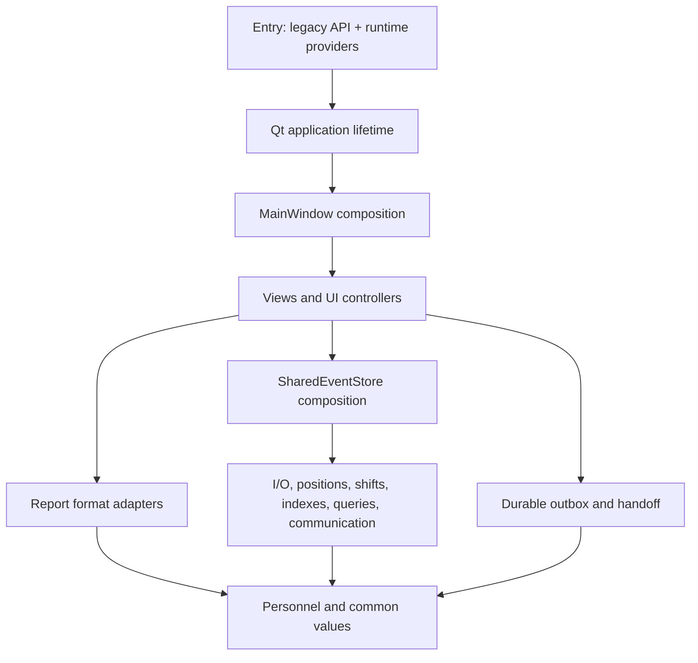

# Current architecture and verification map — 2026-10-16

Only feature/v125-modularization-20261013. Main and production v1.2.5 protected.
This is development verification, not field/production acceptance.

## Current structure

43 source files; entry 88 lines, MainWindow composition 77, largest module 366.
The full per-file responsibility/line/commit inventory is in
MODULARIZATION_REPORT_EL.md and validation/structure-20261016/modules.json.
The original monolith inventory remains in Git history at checkpoint a323d9e.

| Responsibility | Current owners |
|---|---|
| Compatibility/launch composition | position_tracking.py, ui_application, ui_main, ui_context |
| Settings and paths | settings, machine_queue |
| Immutable personnel and roster import | personnel, common |
| Active START/END, corrections, idempotent receipts | positions, store_io |
| Shift membership/lifecycle | shifts |
| SQLite snapshots and history index | shift_index, session_index |
| Event projection and clock-window queries | event_queries |
| Shared clients/messages/commands | communication |
| Store composition, audit and backup | store |
| Durable replay and account transitions | offline, handoff, windows_session |
| Offline local Windows EXE bootstrap | bootstrap |
| Text/HTML, PDF, Word, Excel reporting | report_text, pdf, documents, statistics |
| Palette/style data and coherent repaint | theme, rendering |
| Qt view/assets/map | ui_view, ui_assets, ui_map, artwork |
| Qt business interaction controllers | ui_configuration, ui_selection, ui_positions, ui_shifts, ui_shift_end |
| Qt communication/admin/history/report dialogs | ui_communication, ui_messages, ui_admin, ui_history, ui_reports |
| Safe exit and initial presentation | ui_lifecycle, ui_presentation |

## Dependency and composition rules

Entry supplies explicit WindowServices config/path/file-opening callbacks. UI
capability mixins compose into the small MainWindow; store capability mixins
compose into SharedEventStore and share its explicit filesystem/SQLite state.
Services do not import the entry or UI. Reporting uses narrow session-source
contracts. Optional Qt/docx/openpyxl dependencies load only when needed by exports.
Legacy entry exports remain compatible. No import cycles or duplicate effective
business-method implementations. See tests/architecture_regression.py.

Whole-module AST audit: all 66 store methods unchanged versus 0f6fee5; all 50
effective UI methods unchanged after explicit path callback normalization.
Constructor composition is checked by real UI workflows. SQL/HTML string values
are compared using complete owning-module ASTs, without text dedentation.
Evidence: validation/structure-20261016/ast-audit.json.

## Resolved evidence and current certification

Initial capture contained console focus-border changes AND genuine unpainted
white native surfaces. CI background now owns a responsive message loop; initial
native presentation waits for actual completed Qt paint before uncloaking once.
Theme changes still use normal visible coherent repaint. No threshold change,
frame hiding/exclusion or screenshot overlay. See CONTINUATION.md for exact runs.

b943a869: full Windows 38865827943 SUCCESS, strict startup 0/20 and theme 0/30,
30/30 confirmed clicks; Linux/module gate PASS and real EXE artifact uploaded.
Latest complete structural source d128e6d: 43 local scripts PASS, Linux 38868080997
and gate 38868081064 PASS. Windows 38868081099 final certification pending,
including new external frozen-EXE mouse/keyboard data workflow.

## Field acceptance gaps

All automated datasets are synthetic/temporary. Local contention and fault
injection do not certify real SMB power loss or NTFS/share ACL. Account identity
simulation does not certify actual Windows logoff/reboot/session switching.
Required: real host + 2+ clients, denied/reconnected share, power-off/replay,
10:00 and 12/24h transitions, long-running responsiveness and blocked-I/O shutdown,
cached cold launch, small/high-DPI displays and real printing. Preserve original
START/END IDs, timestamps, history and pending queue throughout those trials.
No operational data or production deployment is authorized by this work.
